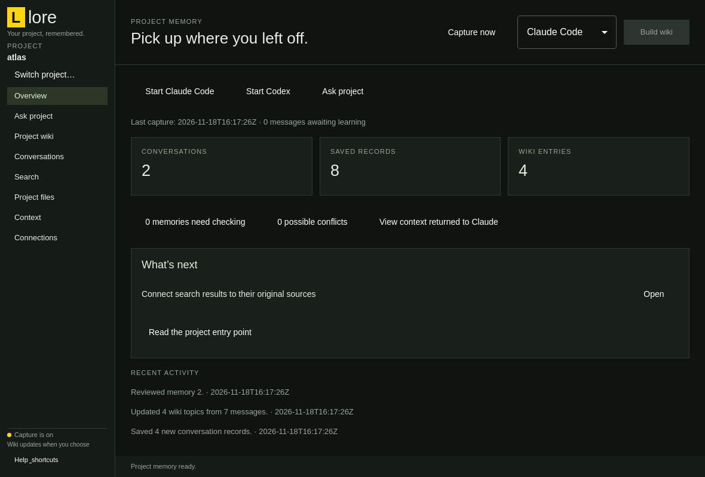

# Lore

A local memory app for projects you build with **Claude Code or Codex**.
It captures saved conversation records, searches them with SQLite FTS5, and
turns new messages into a wiki with references to the original evidence.
**BRAIN.md is the small file future sessions read first.**

## Project intelligence

- **Ask project** answers questions through your selected Claude Code/Codex
  login, using retrieved evidence with clickable references. Unknown references
  are rejected. Lore reports missing evidence and avoids a model call when
  retrieval finds nothing. Answer generation uses your tool's model quota.
- **Project files → Index project files** builds a local file and symbol map.
  Git ignore rules and common secret/generated-file exclusions are respected.
  Once enabled, capture checks this index each minute. Changed or removed files
  flag related wiki entries for review. This is a freshness check, not a proof
  that a remembered claim is correct. Ask refreshes an existing file index.
- **Project wiki** provides Confirm, Correct, Outdated, and Forget actions.
  Corrections create a replacement with history. Forgotten supporting messages
  and related memories are excluded from future recall and learning; original
  records remain in the archive. Possible conflicts are flagged for review.
- **Context** previews a bounded task briefing and shows recent context returned
  by Claude hooks. A hook response records emitted context, not proof that a
  model read or followed it. The Overview separates capture, learning, and review
  activity rather than treating them all as a connected session.
- **Connections → Local semantic search** offers an optional local embedding
  index. Install/open [Ollama](https://ollama.com/download), then choose
  **Download model & enable** (EmbeddingGemma, about 622 MB). Embedding requests
  use loopback only. Retrieval combines keyword ranking and vector similarity;
  new captures and memory changes refresh enabled indexes. Update index resumes
  interrupted work. If Ollama is unavailable, Lore reports a keyword fallback.

Code/document excerpts selected for Ask are sent to your chosen coding tool.
Filename exclusions do not guarantee removal of secrets; review the files you
choose to index. No project text is sent to a Lore-operated service. The local
embedding model is downloaded separately and has its own license.

Under **Connections → Notifications**, turn notification banners off. Banners
clear on success or after 12 seconds; temporary database/export contention is
retried quietly. **Recent issues** keeps diagnostics for the current app session.

For headless use:

```sh
lore index --project /path/to/project --json
lore brief --project /path/to/project --query 'Where did we leave off?' --json
lore ask --project /path/to/project --provider claude --query 'Why SQLite?' --json
lore review --project /path/to/project --id 3 --action confirmed --json
lore semantic --project /path/to/project --action index --json
lore deliveries --project /path/to/project --json
```

MCP also exposes `brain_briefing` and `brain_files`. Existing search and archive
tools remain available. Old databases migrate automatically; original records
remain intact. Back up the project's private `.lore/` directory to move memory
between machines.

`python3 tests/evaluate_retrieval.py` measures top-three recall and unknown-query
abstention on a fictional project. Add `--semantic` to evaluate the real local
embedding model after installing it. The default test and HTTP embedding fixture
exercise ranking and protocol behavior; they do not establish real-model
semantic accuracy on your project.

For development on another machine, start with the
[handoff](docs/handoff.md) and [contributor instructions](AGENTS.md).
Linux/Omarchy and Windows builds are available.

Use **Help & shortcuts → Check for updates** to open the GitHub releases page.

## Install on Windows

1. Open the [latest release](https://github.com/MadeBySaints/lore/releases/latest)
   and download **Lore-Setup-0.3.2.exe**.
2. Run the installer, then open **Lore** from the Start menu. The installer
   includes Qt and Microsoft runtime dependencies and installs for your user.
3. Choose **Choose folder**, select your project, and review **Check tools**.
   Install, sign in, or locate Claude Code/Codex using the buttons if needed.
4. Choose **Connect project**. Capture starts automatically. Use **Start Claude
   Code** or **Start Codex** to begin a new session in the right project folder.

Lore remembers your project and capture preferences next time. Choose **Build
wiki** to learn from new messages, or enable **Update the wiki automatically**
under Connections. Automatic learning is off for a new project and uses the
selected provider's model quota when enabled. Tool checks inspect local sign-in
state; they do not make model calls.

The installer is an unsigned preview build. Its uninstaller removes the app,
while project conversation archives and wiki pages remain in their projects.

For the portable build, keep the entire downloaded folder together and open
**lore-desktop.exe**. No PowerShell command is needed to open the interface.

## Build and open

Requires Linux, Qt 6 base/declarative/Wayland development packages, qmake6,
and a C++17 compiler. No Node or Python runtime is needed by the app.

```sh
./bin/build
./build/lore open --project /absolute/path/to/project
```

Choose **Choose folder**, select your project, then **Connect project**.
Connect preserves existing text in AGENTS.md and CLAUDE.md, prepends a managed
pointer to BRAIN.md, merges lifecycle hooks into .claude/settings.local.json,
and excludes private memory from Git. Start a new agent session to load the
new instructions. Codex AGENTS.override.md or a disabled Claude hook can alter
what is loaded; Lore cannot force a model to follow an instruction.

Install the Arch package and launcher entry with `./bin/install`. This also
makes `lore` available on PATH. Use an absolute path to build/lore in the
commands below if running without installation.

If a system package install is unavailable, `./bin/install-user` installs the
built binary and launcher entry for your user without sudo. Run it again after
rebuilding. The Arch package remains the default system installation method.

## Windows build and Claude Code hooks

Use a Visual Studio 2022 x64 developer PowerShell with the C++ build tools and
Qt 6.8+ MSVC 2022 x64 tools on PATH. Python is needed only for integration tests.

```powershell
.\bin\build.ps1
.\bin\test.ps1
python tests/integration.py
.\bin\package-windows.ps1
.\bin\installer-windows.ps1

.\build\windows\lore.exe init --project 'C:\Work\my-project'
.\build\windows\lore.exe connect --project 'C:\Work\my-project'
```

Keep the complete `build/windows` folder together; it contains runtime
dependencies in addition to lore.exe and the console-free lore-desktop.exe
launcher. `installer-windows.ps1` requires Inno Setup 6 and produces the per-user
setup program. Windows CI builds, installs, launches, and uninstalls this package,
checks that project memory survives, and uploads installer and portable artifacts.

Connect writes the same project-local settings used on Linux. Hooks use
Claude Code's **exec form**: `command` is the absolute lore.exe path and `args`
contains `hook`, `--project`, and the project directory as separate strings.
No shell is involved, so neither Git Bash nor PowerShell quoting is required.
Use a current Claude Code version that supports command hooks with `args`.
Start a new Claude Code session after connecting. Run connect again after moving
the executable or project; it updates Lore's hooks and preserves unrelated hooks.
Existing Linux shell-form Lore hooks migrate on reconnect.

Windows tests cover native hook invocation, source capture, context injection,
MCP stdio, and fake-provider learning. Live Claude/Codex authentication and their
installed Windows CLI variants require separate validation on the target machine.

## The memory loop

1. **Capture.** Claude project hooks import saved transcripts at session start,
   prompts, responses, before compaction, and session end. Prompt hooks search
   the archive and add short, cited evidence to context. Keep **Capture** on in
   the app, or `lore watch` running, to capture Codex JSONL rollouts too.
2. **Learn.** Choose Codex or Claude, then **Build wiki**. Pending user and assistant
   messages are sent through your authenticated CLI to that provider. The
   response becomes facts, decisions, next steps, and questions with validated
   event references. Model output can be wrong; citations make it auditable.
3. **Resume.** The next coding session follows AGENTS.md or CLAUDE.md to
   BRAIN.md, then loads only the relevant wiki pages or conversation records.

**Automatic learning** is optional under Connections. After 60 seconds without
newly captured records, it sends a batch to the selected provider. It uses that
provider's quota. Lore remembers this preference separately for each project;
new projects start with automatic learning off. Capture and keyword
search themselves make no model calls. Failed or cancelled learning does not
mark messages learned, so it can be retried.

Each learning pass takes at most 40 messages within a context budget. Run it
again to work through a backlog. The app does this automatically while optional
automatic learning is enabled. Original records are never replaced by summaries.

## Agent commands

```sh
lore init --project /path/to/project --json
lore connect --project /path/to/project --json
lore sync --project /path/to/project --json
lore watch --project /path/to/project --json
lore search --project /path/to/project --query 'database choice' --json
lore status --project /path/to/project --json
lore context --project /path/to/project
lore import --project /path/to/project --provider claude --file session.jsonl --json
lore learn --project /path/to/project --provider codex --dry-run --json
lore learn --project /path/to/project --provider codex --json
lore skill install --project /path/to/project --json
```

Dry run prints the exact batch and prompt without contacting a provider. The
skill command installs a bundled agent skill inside the selected project's
.agents/skills/lore directory. No global agent configuration is changed by
init, connect, or skill install.

Codex sessions are read from `$CODEX_HOME/sessions` (default ~/.codex/sessions);
Claude sessions from `$CLAUDE_CONFIG_DIR/projects` (default ~/.claude/projects).
Use `--codex-root` and `--claude-root` on sync/watch for other locations.
Only transcripts whose recorded working directory is the selected project or
a descendant are imported. Unrelated projects are excluded. Subprojects inside
that directory are included. No working-directory metadata means no import.

Changed files are rescanned and individual records deduplicated. Transcript
revisions are retained as history. A partial final JSON record is retried at
the next sync; malformed complete records are reported. Sync exits 1 when it
reports warnings, including unavailable explicitly selected transcript directories.
Default directories that have not been created yet are treated as waiting for
the first coding session. Explicit import
bypasses the unchanged-file scan cache.

## MCP for either coding tool

The server uses stdio and exposes read-only `brain_context`, `brain_search`,
`brain_wiki`, `brain_sessions`, and paginated `brain_session` tools. Registration
is optional; project instructions and CLI search work without it.

For Claude, run from your project:

```sh
claude mcp add --scope local lore -- /usr/bin/lore mcp --project /path/to/project
```

For Codex (choose a distinct name per project, since this registration is in
the user's Codex config):

```sh
codex mcp add lore-myproject -- /usr/bin/lore mcp --project /path/to/project
```

MCP queries read captured data; the GUI, watcher, or Claude hooks do the capture.

## Files and portability

```text
your-project/
  BRAIN.md                     small, generated entry point
  AGENTS.md / CLAUDE.md         existing instructions plus managed pointer
  .claude/settings.local.json  project-local Claude hooks
  .lore/                       private archive (owner-only on Unix)
    brain.sqlite               raw records, search index, generated memory
    brain.sqlite-wal / -shm     active SQLite sidecars
    wiki/index.md              wiki contents
    wiki/1.md                  dated page with evidence citations
    sources/index.md           conversation index
    sources/<id>.md            readable conversation with event anchors
    sources/<id>.jsonl         captured original records in import order
```

Lore updates its managed Markdown blocks atomically and preserves text outside
them. Exported wiki and source pages are generated files; edit your own notes
outside the managed BRAIN.md block instead. Wiki entries remain dated history.
When new evidence changes a decision or completes a task, learning can supersede
an earlier entry with a linked replacement. Superseded next steps leave BRAIN.md,
and their original evidence stays available. Claims should still be checked
against current code and newer entries. BRAIN.md is an index; copying it alone
does not copy the archive.

Capture only records the data exposed by saved tool logs. Hidden reasoning,
unsaved sessions, attachments not included in the logs, and web/app conversations
without local JSONL transcripts are unavailable. No remote sync, embeddings,
fuzzy search, encryption, or email integration is included in this version.

Stop the app, watchers, and hooks before copying the .lore directory as a backup;
include SQLite sidecars if present. Transcript content may contain sensitive
project information. Storage and exports stay local; Learn sends its displayed
batch to your chosen provider. Lore has no telemetry.

To disconnect Claude, remove only Lore's hook commands from the project-local
settings file and the `lore:start` / `lore:end` blocks in AGENTS.md and CLAUDE.md.
Stop the watcher for Codex. Remove optional MCP registrations with the tool's
`mcp remove` command. Existing session transcripts are never changed.

## Keyboard

| Key | Action |
| --- | --- |
| Space | Capture now |
| Ctrl+K | Search memory |
| Ctrl+O | Choose a project folder |
| F11 | Toggle full screen |
| Escape | Close document or help |
| ? | Show shortcuts |
| Q | Quit; confirm if learning is active |

## Validate

```sh
./bin/build
./bin/test
python3 tests/integration.py
```

Tests use temporary projects and fake provider processes, without network or
changes to your existing agent settings. The UI follows Omarchy's live accent,
rounding, and language; English and Danish are included. Translation and theme
tests use temporary files rather than changing the desktop configuration.

Folder selection uses Windows' native file dialog or the Linux desktop portal.
GUI preferences and optional tool locations are stored in Lore's local app data
folder. Provider credentials stay with Claude Code/Codex. Capture runs in a
background worker so the interface stays usable while conversations are scanned.
